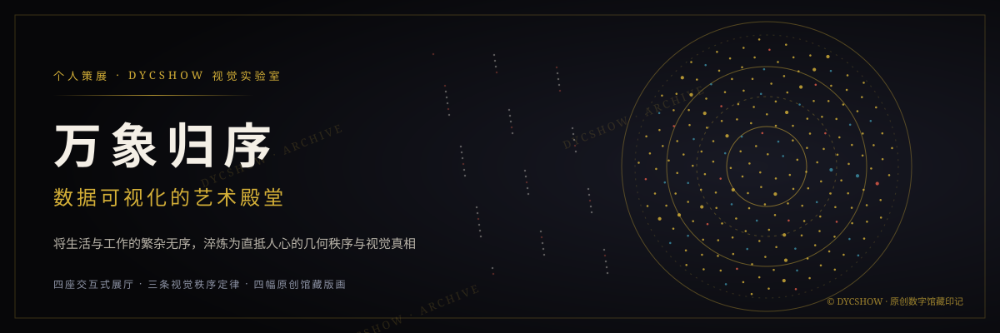
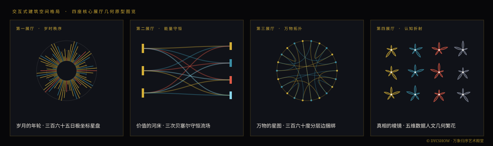

<p align="center">
  <strong><a href="./README.md">简体中文</a></strong> &nbsp;|&nbsp; <a href="./README_EN.md">English</a>
</p>

<p align="center">
  
</p>

<h1 align="center">万象归序</h1>

<p align="center">
  <strong>DYCSHOW 个人策展的数据可视化艺术殿堂</strong><br/>
  将生活与工作的繁杂无序，淬炼为直抵人心的几何秩序与视觉真相
</p>

<p align="center">
  <a href="https://dycshow.github.io/pantheon-of-data-art/"><strong>在线步入艺术殿堂 ↗</strong></a>
  &nbsp;·&nbsp;
  <a href="#section-manifesto">策展手记</a>
  &nbsp;·&nbsp;
  <a href="#section-audio">策展语音导览</a>
  &nbsp;·&nbsp;
  <a href="#section-halls">展厅总览</a>
  &nbsp;·&nbsp;
  <a href="#section-plates">馆藏版画</a>
  &nbsp;·&nbsp;
  <a href="#section-laws">视觉秩序定律</a>
  &nbsp;·&nbsp;
  <a href="#section-architecture">本地运行与开源图谱</a>
</p>

---

<a id="section-manifesto"></a>
## 策展人手记

> **在 AI 三秒即可生成海量图表的时代，人类最稀缺的不再是工具，而是“看见结构与秩序”的审美与洞察。这是一座致力于将生活与工作的繁杂无序，雕刻为直抵人心之视觉表达的艺术殿堂。**

市面上绝大多数的数据表达都止步于千篇一律的柱状图、折线图或后台仪表盘。然而真实的生活与工作从来不是整齐的电子表格——它是**被碎片打断的三百六十五天、不知去向的时间与资本、盘根错节的系统因果，以及被“平均值”掩盖的个体代价**。

**DYCSHOW 视觉实验室**建造这座《万象归序》个人艺术殿堂，旨在回答一个核心命题：  
**如何用严密的几何结构与美术馆级视觉审美，让普通人一眼看懂复杂世界的内在秩序？**

为此，本殿堂中的所有交互展品均支持在 **`[混沌原貌]`** 与 **`[万象归序]`** 之间实时物理变形与数学推演，让观展者亲眼见证秩序诞生那一刻的美学震撼。

---

<a id="section-audio"></a>
## 策展人语音导览（声学馆藏）

> **不仅有看得见的几何秩序，更有听得见的策展温度。** 本殿堂现已配备全馆六段沉浸式语音导览；在线展厅顶部设有「全馆语音导览」连续巡礼按钮，每座展厅铭牌处均可单独点播。

- **声学策展选型（中文首席策展人声像）**：选用沉稳克制的 **「白桦」低男声（基频 111.4 赫兹，磁性深沉语调，每秒 3.77 字黄金叙事语速）**——兼顾美术馆建筑的肃穆纵深感与数字诗学的清晰节奏，避免过慢衰老感或轻快娱乐感。

| 导览篇章 | 解说核心内容 | 在线展厅直达 | 独立音频直听 |
|---|---|---|---|
| **序厅 · 万象归序策展宣言** | AI 时代的秩序之眼，从电子表格焦虑走向五重视觉圣殿（41 秒） | [步入序厅](https://dycshow.github.io/pantheon-of-data-art/#atrium) | [收听纯中文解说 ↗](https://dycshow.github.io/pantheon-of-data-art/assets/audio/00-prologue-zh.mp3) |
| **第一展厅 · 岁月的年轮** | 一年 365 天四大维度与跨日心流弧线解析（40 秒） | [步入第一展厅](https://dycshow.github.io/pantheon-of-data-art/#hall-chronos) | [收听纯中文解说 ↗](https://dycshow.github.io/pantheon-of-data-art/assets/audio/01-chronos-zh.mp3) |
| **第二展厅 · 价值的河床** | 守恒织锦追踪生命资本流向与认知觉醒干预机制（38 秒） | [步入第二展厅](https://dycshow.github.io/pantheon-of-data-art/#hall-flux) | [收听纯中文解说 ↗](https://dycshow.github.io/pantheon-of-data-art/assets/audio/02-flux-zh.mp3) |
| **第三展厅 · 万物的星图** | 三百六十度分层边捆绑星盘与十大现实命题解码器（33 秒） | [步入第三展厅](https://dycshow.github.io/pantheon-of-data-art/#hall-constellation) | [收听纯中文解说 ↗](https://dycshow.github.io/pantheon-of-data-art/assets/audio/03-constellation-zh.mp3) |
| **第四展厅 · 真相的棱镜** | 一百二十个决策样本五态变形，戳破均值谎言（40 秒） | [步入第四展厅](https://dycshow.github.io/pantheon-of-data-art/#hall-prism) | [收听纯中文解说 ↗](https://dycshow.github.io/pantheon-of-data-art/assets/audio/04-prism-zh.mp3) |
| **第五展厅 · 秩序的信仰** | 黑曜石金箔四幅馆藏版画与视觉秩序三定律总结（55 秒） | [步入第五展厅](https://dycshow.github.io/pantheon-of-data-art/#hall-sanctuary) | [收听纯中文解说 ↗](https://dycshow.github.io/pantheon-of-data-art/assets/audio/05-sanctuary-zh.mp3) |

---

<a id="section-halls"></a>
## 壹 · 四座交互式展厅

<p align="center">
  
</p>

| 展厅 | 现实命题（从无序到有序） | 核心交互体验 |
|---|---|---|
| **第一展厅 · 岁月的年轮** | 一年三百六十五天、八千七百六十个小时的注意力碎片化与深度创造节律 | **极坐标年轮星盘叠加弹簧粒子物理**：一键将漫天时间尘埃凝聚为天体年轮，黄金弧线串联连续心流周期，支持维度筛选与逐日透视 |
| **第二展厅 · 价值的河床** | 个人时间、金钱与精力如何流向复利护城河，又在哪些管道悄悄漏损 | **能量守恒冲积河床叠加发光流场**：从无序暴雨收敛为清晰流向；开启「认知觉醒干预」可实时观察隐形内耗回流为自由度净值 |
| **第三展厅 · 万物的星图** | 复杂系统、供应链、知识星系与开源表达之间的跨界耦合拓扑 | **三百六十度分层边捆绑星盘**：拒绝传统无序的“毛线球”网络图，点击任意生活或工作难题即可点亮对应视觉解法与避坑准则 |
| **第四展厅 · 真相的棱镜** | AI 时代如何识破 AI 生成图表的“均值谎言”，并还原真实个体的立体尊严 | **五态实景变形**：同一份一百二十人决策数据在「混沌散点 → 平均柱状图 → 蜂群分布 → 权衡前沿 → 五维人文繁花」间丝滑切换 |

---

<a id="section-plates"></a>
## 贰 · 馆藏级秩序版画

每一座展厅均配有一幅黑曜石虚空与古典金箔美学的原创馆藏版画，定格“混沌坍缩为秩序”的瞬间。所有馆藏图像均已嵌入 **DYCSHOW 数字水印与馆藏印记**（访问在线艺术殿堂可全屏放大鉴赏）：

<table>
  <tr>
    <td width="50%" align="center">
      
      <br/><strong>版画壹 · 《岁月的年轮》</strong>
      <br/><sub>碎纸与尘埃凝聚为黄铜与金箔天体星盘，象征时间秩序的诞生</sub>
    </td>
    <td width="50%" align="center">
      
      <br/><strong>版画贰 · 《价值的河床》</strong>
      <br/><sub>金箔、朱砂与铜绿丝线从死结中被梳理成恢弘流动的守恒织锦</sub>
    </td>
  </tr>
  <tr>
    <td width="50%" align="center">
      
      <br/><strong>版画叁 · 《万物的星图》</strong>
      <br/><sub>游离尘埃沿着捆绑弧线聚拢为几何晶体与浑天仪核心，揭示复杂拓扑</sub>
    </td>
    <td width="50%" align="center">
      
      <br/><strong>版画肆 · 《真相的棱镜》</strong>
      <br/><sub>无序银色碎片穿过水晶棱镜，折射出纯净的谐振波纹与五维人文繁花</sub>
    </td>
  </tr>
</table>

---

<a id="section-laws"></a>
## 叁 · 视觉秩序三定律

1. **反平庸定律**：真正的殿堂不复制千篇一律的后台模板，每一种现实复杂度都值得拥有专属的几何语言。
2. **秩序守恒定律**：可视化不是把数字装饰得好看，而是强迫散乱的时间、资本与因果显出守恒的流向。
3. **人文尺度定律**：拒绝被冰冷的“平均值”抹平个体差异，用几何繁花保存生命本身的复杂质地。

---

<a id="section-architecture"></a>
## 肆 · 本地运行、技术附录与版权说明

如果你想在本地运行、二次探索或扩展新的生活与工作视觉命题，可按如下方式启动开发服务器：

```bash
git clone https://github.com/dycshow/pantheon-of-data-art.git
cd pantheon-of-data-art
npm install
npm run dev
```

- **构建生产发布包**：执行 `npm run build`，静态文件将生成至 `dist/` 目录，可无缝部署于任意静态页面托管服务。
- **技术方法论附录（纯中文版）**：关于世界经典数据可视化理论与主流开源几何引擎选型边界的深度整理，见 [docs/OPEN_SOURCE_ATLAS.md](./docs/OPEN_SOURCE_ATLAS.md)。
- **原创馆藏声明与水印保护**：本殿堂的策展结构、四幅馆藏数字版画（`public/assets/plates/`）及交互式画布模型均内置 **© DYCSHOW 馆藏水印与印记**。欢迎阅读、学习与灵感交流，请勿移除作者印记或直接搬运用于商业成品展示。

<p align="center">
  <sub>个人策展与视觉设计：<a href="https://github.com/dycshow"><strong>DYCSHOW</strong></a> · 献给 AI 时代的人类视觉素养</sub>
</p>
