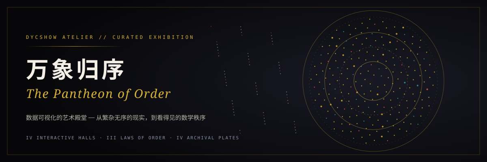
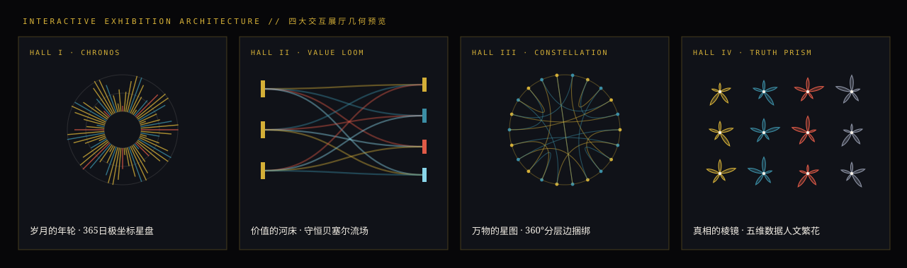
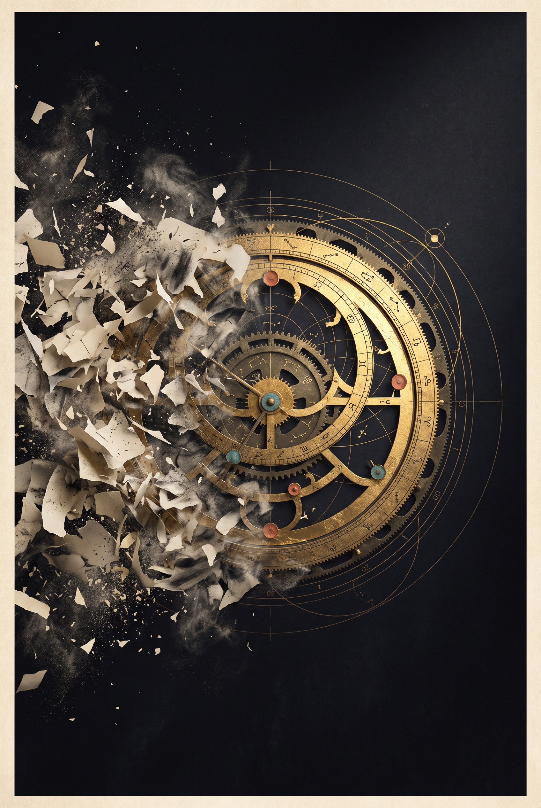
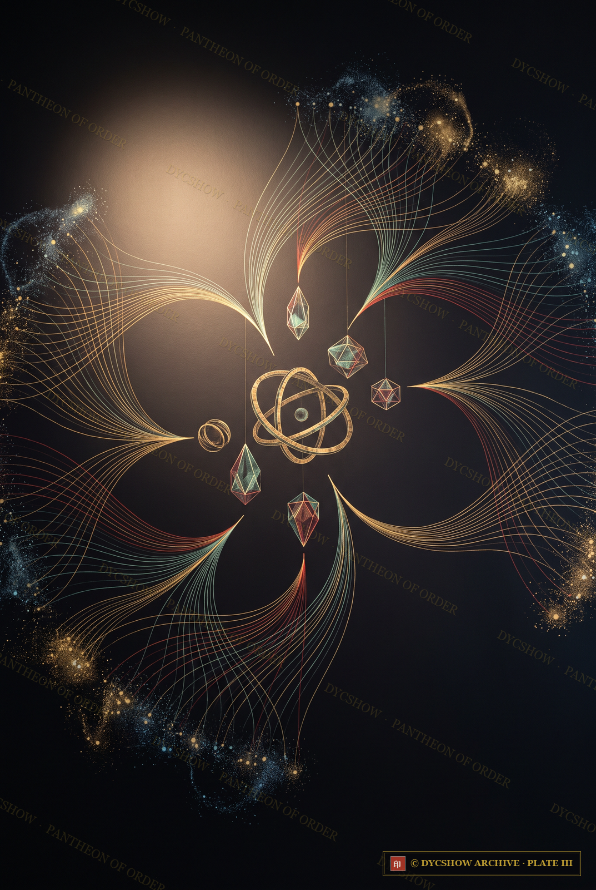
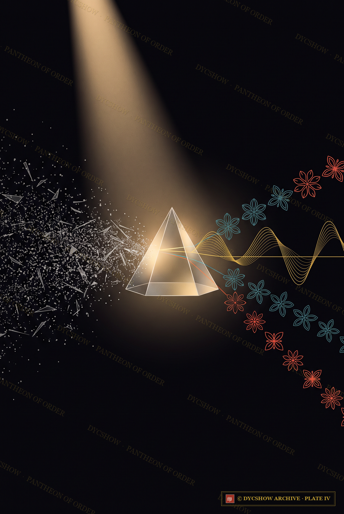

<p align="center">
  
</p>

<h1 align="center">万象归序 · The Pantheon of Order</h1>

<p align="center">
  <strong>DYCSHOW 个人策展的数据可视化艺术殿堂</strong><br/>
  将生活与工作的繁杂无序，雕刻为一眼震撼的几何秩序与美学表达
</p>

<p align="center">
  <a href="https://dycshow.github.io/pantheon-of-data-art/"><strong>在线步入艺术殿堂 · Enter Live Museum ↗</strong></a>
  &nbsp;·&nbsp;
  <a href="#-四座交互式展厅--interactive-halls">展厅预览</a>
  &nbsp;·&nbsp;
  <a href="#-馆藏级秩序圣像--archival-plates">馆藏版画</a>
  &nbsp;·&nbsp;
  <a href="./docs/OPEN_SOURCE_ATLAS.md">技术方法论附录</a>
</p>

---

## 策展人手记 · Why This Pantheon Exists

> **在 AI 能力过剩、三秒就能生成无数报表与文字的时代，人类最稀缺的不再是工具，而是“看见结构与秩序”的审美与洞察。**

市面上的大多数可视化作品止步于千篇一律的柱状图、折线图或后台仪表盘。然而真实的生活与工作从来不是整齐的表格——它是**被碎片打断的 365 天、不知去向的时间与资本、盘根错节的系统因果，以及被“平均值”掩盖的个体代价**。

**DYCSHOW ATELIER** 建造这座《万象归序》艺术殿堂，旨在回答一个核心命题：  
**如何用严密的几何结构与极致的美术馆视觉，让普通人一眼看懂复杂世界的内在秩序？**

为此，本殿堂中的所有交互展品都支持在 **`[混沌原貌 · Raw Entropy]`** 与 **`[万象归序 · Mathematical Cosmos]`** 之间实时变形推演，让人亲眼见证秩序诞生那一刻的震撼。

---

## Ⅰ. 四座交互式展厅 · Interactive Halls

<p align="center">
  
</p>

| 展厅 | 现实命题（从无序到有序） | 核心交互体验 |
|---|---|---|
| **Hall I · 岁月的年轮**<br/>*Chronos Astrolabe* | 一年 365 天、8760 小时的注意力碎片化与深度创造节律 | **极坐标年轮星盘 × 弹簧物理**：一键将漫天时间尘埃凝聚为天体年轮，黄金弧线串联连续心流周期，支持维度筛选与逐日透视 |
| **Hall II · 价值的河床**<br/>*The Loom of Value* | 个人时间、金钱与精力如何流向复利护城河，又在哪悄悄漏损 | **能量守恒冲积河床 × 发光流场**：从无序暴雨收敛为清晰流向；开启「认知觉醒干预」可实时观察 34% 隐形内耗回流为自由度净值 |
| **Hall III · 万物的星图**<br/>*Constellation of Order* | 复杂系统、供应链、知识星系与开源表达之间的耦合拓扑 | **360° 分层边捆绑星盘**：拒绝传统“毛线球”网络图，点击任意生活/工作难题即可点亮对应视觉形态与避坑指南 |
| **Hall IV · 真相的棱镜**<br/>*The Prism of Truth* | AI 时代如何识破“均值谎言”，并还原个体的立体尊严 | **五态实景变形**：同一份 120 人决策数据在「平均柱状图 → 蜂群分布 → 帕累托前沿 → 五维数据人文繁花」间丝滑切换 |

---

## Ⅱ. 馆藏级秩序圣像 · Archival Plates

每一座展厅均配有一幅黑曜石虚空与古典金箔美学的馆藏版画，刻画“混沌坍缩为秩序”的瞬间（点击在线展厅可全屏放大鉴赏）：

<table>
  <tr>
    <td width="50%" align="center">
      
      <br/><strong>Plate I · 岁月的年轮 (Chronos Astrolabe)</strong>
      <br/><sub>碎纸与尘埃凝聚为黄铜与金箔天体星盘，象征时间秩序的诞生</sub>
    </td>
    <td width="50%" align="center">
      
      <br/><strong>Plate II · 价值的河床 (The Loom of Value)</strong>
      <br/><sub>金箔、朱砂与铜绿丝线从死结中被梳理成恢弘流动的守恒织锦</sub>
    </td>
  </tr>
  <tr>
    <td width="50%" align="center">
      
      <br/><strong>Plate III · 万物的星图 (Constellation of Order)</strong>
      <br/><sub>游离尘埃沿着捆绑弧线聚拢为几何晶体与浑天仪核心，揭示复杂拓扑</sub>
    </td>
    <td width="50%" align="center">
      
      <br/><strong>Plate IV · 真相的棱镜 (The Prism of Truth)</strong>
      <br/><sub>无序银色碎片穿过水晶棱镜，折射出纯净的谐振波纹与五维人文繁花</sub>
    </td>
  </tr>
</table>

---

## Ⅲ. DYCSHOW 视觉秩序三定律

1. **反平庸定律（Reject Default Templates）**：真正的殿堂不复制模板，每一种现实复杂度都值得拥有专属的几何语言。
2. **秩序守恒定律（Illuminate Structural Truth）**：可视化不是把数字装饰得好看，而是强迫散乱的时间、资本与因果显出守恒的流向。
3. **人文尺度定律（Preserve Human Dignity）**：拒绝被冰冷的“平均值”抹平个体差异，用几何繁花保存生命本身的复杂质地。

---

## Ⅳ. 本地运行与开源附录 · Run Locally & Open Appendix

如果你希望在本地探索、二开或贡献新的生活与工作展厅命题：

```bash
git clone https://github.com/dycshow/pantheon-of-data-art.git
cd pantheon-of-data-art
npm install
npm run dev
```

- **构建静态发布包**：`npm run build`（输出至 `dist/`，可直接部署于 GitHub Pages 或任意静态托管）
- **策展技术附录**：关于世界经典可视化理论与开源技术栈选型边界的深度整理，见 [docs/OPEN_SOURCE_ATLAS.md](./docs/OPEN_SOURCE_ATLAS.md)

<p align="center">
  <sub>Curated &amp; Designed by <a href="https://github.com/dycshow"><strong>DYCSHOW</strong></a> · Crafted for Human Visual Literacy in the AI Era</sub>
</p>
