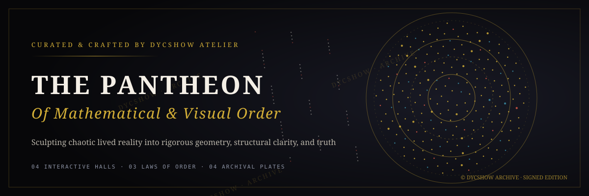
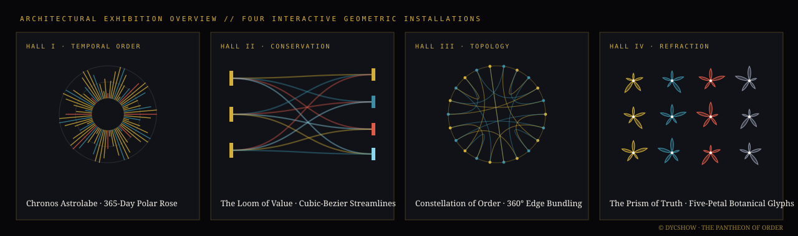
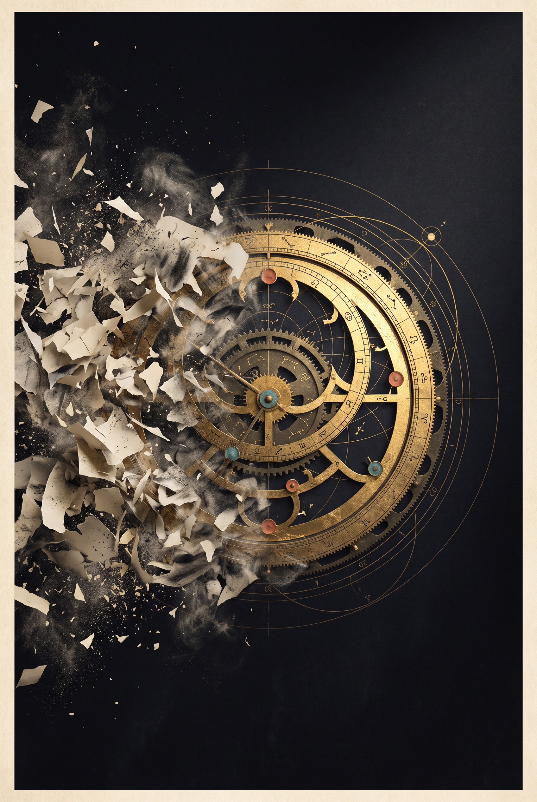
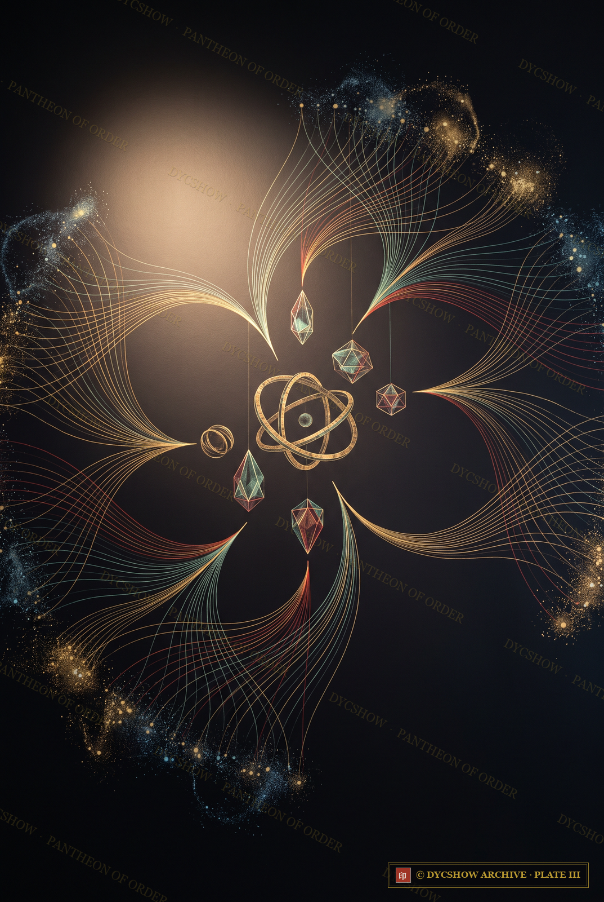
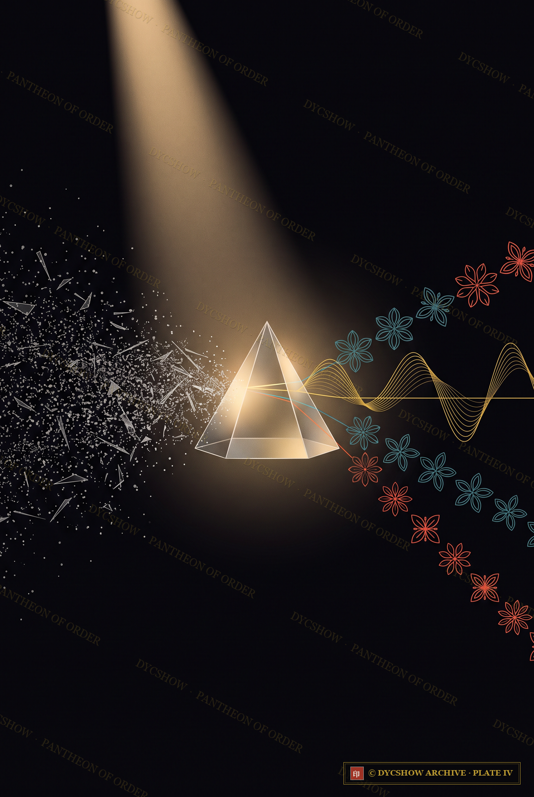

<p align="center">
  <a href="./README.md">简体中文</a> &nbsp;|&nbsp; <strong><a href="./README_EN.md">English</a></strong>
</p>

<p align="center">
  
</p>

<h1 align="center">The Pantheon of Order</h1>

<p align="center">
  <strong>A Personal Museum of Data Visualization Art Curated by DYCSHOW</strong><br/>
  Sculpting messy lived reality into rigorous geometry, structural clarity, and visual truth
</p>

<p align="center">
  <a href="https://dycshow.github.io/pantheon-of-data-art/"><strong>Enter Live Museum ↗</strong></a>
  &nbsp;·&nbsp;
  <a href="#section-manifesto">Manifesto</a>
  &nbsp;·&nbsp;
  <a href="#section-audio">Audio Guide</a>
  &nbsp;·&nbsp;
  <a href="#section-halls">Interactive Halls</a>
  &nbsp;·&nbsp;
  <a href="#section-plates">Archival Plates</a>
  &nbsp;·&nbsp;
  <a href="#section-laws">Laws of Order</a>
  &nbsp;·&nbsp;
  <a href="#section-architecture">Run Locally &amp; Atlas</a>
</p>

---

<a id="section-manifesto"></a>
## Curatorial Manifesto

> **In an era where AI generates endless charts in three seconds, the rarest human capability is no longer tooling—it is the visual literacy to discern structure, order, and truth beneath a chaotic world.**

Most data tools stop at flattening human stories into interchangeable bar charts and corporate pies. Yet lived reality is never a clean spreadsheet—it is **365 fragmented days, silent leaks of time and capital, entangled causal systems, and individual dignity erased by statistical averages**.

**DYCSHOW Atelier** built *The Pantheon of Order* around one guiding question:  
**How can open-source geometric rigor and classical museum aesthetics make invisible structural truth effortlessly visible?**

Every interactive installation inside this sanctuary transforms smoothly in real time between **`[Raw Entropy]`** and **`[Mathematical Cosmos]`**, letting visitors experience the visceral birth of order firsthand.

---

<a id="section-audio"></a>
## Curatorial Audio Guide (Acoustic Collection)

> **Geometry you can see, curatorial voice you can hear.** The museum features six bilingual audio-guide tracks: trigger the continuous **Audio Guide Tour** in the top navigation bar or play each hall's narration individually beside its curatorial plaque.

- **Acoustic Voice Profile (English Chief Curator)**: Synthesized in the authoritative **Dean baritone voice (`97.6 Hz` fundamental pitch, calm &amp; deeply resonant delivery)**—chosen to mirror classical gallery solemnity while keeping technical clarity crisp.

| Gallery Chapter | Curatorial Narration Focus | Live Hall | Direct Audio Stream |
|---|---|---|---|
| **Prologue · Curatorial Manifesto** | Why humanity needs visual order in a 3-second AI chart era (40s) | [Enter Atrium](https://dycshow.github.io/pantheon-of-data-art/#atrium) | [Listen in English ↗](https://dycshow.github.io/pantheon-of-data-art/assets/audio/00-prologue-en.mp3) |
| **Hall I · Chronos Astrolabe** | 365 days across four dimensions and golden focus streaks (38s) | [Enter Hall I](https://dycshow.github.io/pantheon-of-data-art/#hall-chronos) | [Listen in English ↗](https://dycshow.github.io/pantheon-of-data-art/assets/audio/01-chronos-en.mp3) |
| **Hall II · The Loom of Value** | Conserved alluvial flows and Cognitive Intervention (35s) | [Enter Hall II](https://dycshow.github.io/pantheon-of-data-art/#hall-flux) | [Listen in English ↗](https://dycshow.github.io/pantheon-of-data-art/assets/audio/02-flux-en.mp3) |
| **Hall III · Constellation of Order** | 360° hierarchical edge bundling for systemic dilemmas (32s) | [Enter Hall III](https://dycshow.github.io/pantheon-of-data-art/#hall-constellation) | [Listen in English ↗](https://dycshow.github.io/pantheon-of-data-art/assets/audio/03-constellation-en.mp3) |
| **Hall IV · The Prism of Truth** | Five-stage morphing on 120 lives exposing the Lie of Averages (42s) | [Enter Hall IV](https://dycshow.github.io/pantheon-of-data-art/#hall-prism) | [Listen in English ↗](https://dycshow.github.io/pantheon-of-data-art/assets/audio/04-prism-en.mp3) |
| **Hall V · The Curator's Sanctuary** | Obsidian-and-gold archival plates and the Three Laws of Order (44s) | [Enter Hall V](https://dycshow.github.io/pantheon-of-data-art/#hall-sanctuary) | [Listen in English ↗](https://dycshow.github.io/pantheon-of-data-art/assets/audio/05-sanctuary-en.mp3) |

---

<a id="section-halls"></a>
## I. Four Interactive Exhibition Halls

<p align="center">
  
</p>

| Hall | Real-World Chaos → Structural Question | Interactive Architecture |
|---|---|---|
| **Hall I · Chronos Astrolabe** | 365 days and 8,760 hours of fragmented attention vs. deep creative cadence | **Polar Radial Rose + Spring Physics**: Collapses drifting daily fragments into an astronomical dial with contiguous golden focus arcs and dimension filtering |
| **Hall II · The Loom of Value** | Where personal time, energy, and capital silently leak away vs. compound into moats | **Conserved Alluvial Tapestry + Luminescent Particles**: Reroutes unmapped rain into causal ribbons; activate Cognitive Intervention to witness lost flow return to sovereignty |
| **Hall III · Constellation of Order** | Systemic fragility across codebases, supply chains, and visual toolkits | **360° Hierarchical Edge Bundling**: Replaces unreadable network hairballs with curved orbital constellations—click any node to inspect scenarios and pitfalls |
| **Hall IV · The Prism of Truth** | Seeing through AI-generated summary averages to restore individual human dignity | **Five-Stage Visual Morphing**: Seamlessly morphs 120 real specimens across Raw Scatter, Bar Averages, Force Beeswarm, Trade-off Frontier, and Five-Petal Botanical Glyphs |

---

<a id="section-plates"></a>
## II. Archival Plates Collection

Each exhibition hall pairs its interactive model with a dark obsidian and antique gold archival plate depicting raw chaos condensing into mathematical form. All plates are protected with baked **© DYCSHOW Provenance Watermarks and Curator Seals** (click any plate inside the live museum for high-resolution inspection):

<table>
  <tr>
    <td width="50%" align="center">
      
      <br/><strong>Plate I · Chronos Astrolabe</strong>
      <br/><sub>Torn calendar fragments collapse into a precision brass celestial timepiece</sub>
    </td>
    <td width="50%" align="center">
      
      <br/><strong>Plate II · The Loom of Value</strong>
      <br/><sub>Gilded, vermilion, and verdigris threads untangle from knots into conserved alluvial flow</sub>
    </td>
  </tr>
  <tr>
    <td width="50%" align="center">
      
      <br/><strong>Plate III · Constellation of Order</strong>
      <br/><sub>Drifting filaments crystallize into faceted geometry and armillary symmetry</sub>
    </td>
    <td width="50%" align="center">
      
      <br/><strong>Plate IV · The Prism of Truth</strong>
      <br/><sub>Dispersed silver dust refracts through crystal facets into harmonic waves and blossoms</sub>
    </td>
  </tr>
</table>

---

<a id="section-laws"></a>
## III. Three Laws of Visual Order

1. **Law of Sovereign Form**: Reject sterile default templates; every complex reality warrants bespoke geometric expression.
2. **Law of Structural Conservation**: Visualization does not merely decorate numbers—it forces scattered time, capital, and causality to account for every unit.
3. **Law of Human Measure**: Never flatten lived human variance into cold averages; preserve bimodal truth and individual dignity.

---

<a id="section-architecture"></a>
## IV. Run Locally, Technical Atlas & Provenance

To explore, build, or extend the museum locally:

```bash
git clone https://github.com/dycshow/pantheon-of-data-art.git
cd pantheon-of-data-art
npm install
npm run dev
```

- **Production Bundle**: Run `npm run build` to output static assets under `dist/`.
- **Curatorial Methodology Atlas (English Edition)**: Read the full theoretical and open-source architectural guide at [docs/OPEN_SOURCE_ATLAS_EN.md](./docs/OPEN_SOURCE_ATLAS_EN.md).
- **Provenance & Attribution**: Architectural composition, interactive visual exhibits, and the four archival plates under `public/assets/plates/` carry embedded **© DYCSHOW** provenance watermarks and seals. Forking and educational study are welcome with clear attribution; removing creator marks or redistributing protected visual assets verbatim as your own work is prohibited.

<p align="center">
  <sub>Curated &amp; Designed by <a href="https://github.com/dycshow"><strong>DYCSHOW</strong></a> · Crafted for Human Visual Literacy in the AI Era</sub>
</p>
